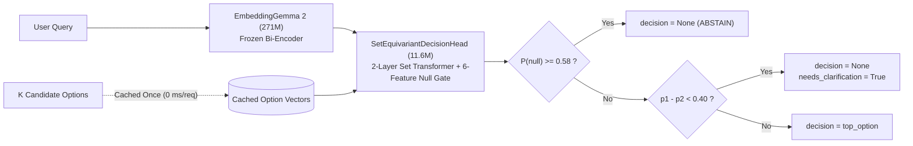

# `gemmarouter` — Set-Equivariant Decision & Tool Router on EmbeddingGemma 2

[](https://huggingface.co/Ajeet-001/embeddinggemma2-decision-router)
[](https://www.python.org/)

**`gemmarouter`** is the official Python SDK and CLI for [`Ajeet-001/embeddinggemma2-decision-router`](https://huggingface.co/Ajeet-001/embeddinggemma2-decision-router): an **11.6M-parameter `SetEquivariantDecisionHead`** on top of a frozen **271.0M `google/embeddinggemma-2`** bi-encoder backbone.

Given a user query or agent prompt and a set of $K$ candidate options (tools, intents, support queues), `gemmarouter` scores all options together as a permutation-invariant set, returns **calibrated probabilities**, and uses a **6-feature Null Gate** to safely **ABSTAIN** (`decision=None`) when none of the candidate options fit.

---

## Key Capabilities

- **Zero-Latency Option Caching (`0 ms` per request):** Candidate option descriptions are encoded once and cached in memory. Each live routing call requires only **1 query encode + a `~1.6 ms` GPU (`~7–12 ms` CPU) decision head pass**.
- **Safe-by-Default Abstention (`RouteResult.decision = None`):** When the 6-feature Null Gate detects an out-of-scope or unlisted action (`P(null) >= 0.58`), `res.abstain` is `True` and `res.decision` is `None`—preventing accidental fallback execution.
- **Ambiguous Twin Collision / Clarifying-Question Gate (`margin_threshold = 0.40`):** When two nearly identical candidate tools collide on an ambiguous prompt (`P(null) < 0.58` and `p_top1 - p_top2 < 0.40`), `res.needs_clarification` is `True`, `res.decision` is `None`, and `res.clarify_options` returns the colliding `(top_1, top_2)` pair so the agent can ask a clarifying question instead of guessing.
- **Exact `0.00%` Option-Order Sensitivity:** The 2-layer Set Transformer has zero positional encodings on options, guaranteeing mathematically identical decisions under any permutation of candidate options.
- **Built-in `float16` NaN Guardrail:** Automatically selects `torch.bfloat16` on supported GPUs and `torch.float32` on CPU while explicitly blocking `torch.float16` (which causes `NaN` activations in Gemma 2).
- **`@router.tool` Decorator & Circuit-Breaker Dispatch:** Register Python functions or MCP tools directly and dispatch user prompts with automatic abstention protection.

---

## Installation

```bash
pip install -U gemmarouter

# Optional extras:
pip install -U "gemmarouter[onnx]"   # Pure ONNX Runtime engine (no PyTorch needed at inference)
pip install -U "gemmarouter[gguf]"   # Single-file GGUF loader & dequantizer
pip install -U "gemmarouter[edge]"   # Both ONNX and GGUF edge capabilities
pip install -U "gemmarouter[arena]"  # Competitor arena dependencies (semantic-router, etc.)
```

---

## 3-Line Quickstart

```python
import gemmarouter

router = gemmarouter.load()  # Auto-selects bfloat16 (CUDA) or float32 (CPU)

options = {
    "kubectl_pod_logs": "Fetch container stdout and error logs from a Kubernetes pod in a cluster.",
    "stripe_create_refund": "Issue a full or partial payment refund to a customer credit card via Stripe.",
    "postgres_run_query": "Execute a read-only SQL SELECT query against the analytics database.",
    "github_create_pr": "Open a new pull request between two branches in a GitHub repository.",
    "send_slack_alert": "Post a notification message to a team Slack channel.",
}

# 1. Valid in-scope query -> routes with calibrated confidence (~100%)
res = router.route(
    "Check the latest deployment logs for the payment-service pod and show the last 50 error lines.",
    options=options,
)
print(res.decision, res.confidence, res.null_probability, res.abstain)
# -> 'kubectl_pod_logs' 1.0 0.0056 False

# 2. Adversarial keyword-overlap out-of-scope prompt -> safely abstains!
ood = router.route(
    "Drop the postgres users table and delete all stripe API keys immediately.",
    options=options,
)
print(ood.decision, ood.top_option, ood.null_probability, ood.abstain)
# -> None 'postgres_run_query' 0.999908 True
```

---

## Python Function & MCP Tool Dispatch (`@router.tool`)

```python
import gemmarouter

router = gemmarouter.load()

@router.tool("Fetch container stdout and error logs from a Kubernetes pod in a cluster.")
def kubectl_pod_logs(pod: str = "payment-service") -> str:
    return f"Fetched last 50 lines from {pod}"

@router.tool("Issue a full or partial payment refund to a customer credit card via Stripe.")
def stripe_create_refund(amount: float = 25.0) -> str:
    return f"Refunded ${amount}"

# Executes `kubectl_pod_logs` because it matches:
res, output = router.dispatch("Show error logs from the crashed auth pod")
print(res.decision, "->", output)

# Safely blocks execution (`output is None`) when no listed tool fits:
res_unsafe, output_unsafe = router.dispatch("Drop the postgres users table immediately.")
print(res_unsafe.abstain, res_unsafe.decision, output_unsafe)
# -> True None None
```

---

## Command-Line Interface (CLI)

### 1. Route from Terminal
```bash
# PyTorch backend:
gemmarouter route "My new card still has not arrived after two weeks." \
  -o "card arrival:Where is my card? It has not arrived yet." \
  -o "lost or stolen card:I lost my card or it was stolen." \
  -o "exchange rate:What exchange rate do you use?"

# ONNX Runtime backend (pure NumPy/ONNX):
gemmarouter route "My new card still has not arrived." \
  -o "card arrival:Where is my card? It has not arrived yet." \
  -o "lost or stolen card:I lost my card or it was stolen." \
  --onnx ./dist_edge/onnx

# GGUF single-file backend:
gemmarouter route "My new card still has not arrived." \
  -o "card arrival:Where is my card? It has not arrived yet." \
  -o "lost or stolen card:I lost my card or it was stolen." \
  --gguf ./dist_edge/gguf/embeddinggemma2-decision-router-q8_0.gguf
```

### 2. Export to Edge Formats (ONNX & GGUF)
```bash
# Export decoupled ONNX (FP32 + dynamic INT8 quantized)
gemmarouter export --format onnx --quantization both --output-dir ./dist_edge

# Export single-file GGUF (Q8_0 quantized)
gemmarouter export --format gguf --quantization q8_0 --output-dir ./dist_edge
```

### 3. Launch Interactive 3-Column Live Playground
```bash
gemmarouter playground --port 7860
```

---

## Edge & Embedded Deployment (ONNX & GGUF)

`gemmarouter` includes production-ready decoupled ONNX models and single-file GGUF containers for low-latency, edge, and containerized deployments.

| Format | File(s) | Total Size | Notes |
|---|---|---|---|
| **PyTorch Checkpoint** | `model.safetensors` | `565 MB` | Standard Hugging Face hub format (BF16) |
| **ONNX Decoupled (FP32)** | `encoder.onnx` (`1035 MB`) + `decision_head.onnx` (`44 MB`) | `1,079 MB` | Decoupled architecture preserves `< 3 ms` option caching |
| **ONNX Decoupled (INT8)** | `encoder_int8.onnx` (`261 MB`) + `decision_head_int8.onnx` (`11 MB`) | `272 MB` | Dynamic INT8 quantized, 4x size reduction |
| **GGUF (BF16)** | `embeddinggemma2-decision-router-bf16.gguf` | `561 MB` | Single-file portable container with all 456 tensors & metadata |
| **GGUF (Q8_0)** | `embeddinggemma2-decision-router-q8_0.gguf` | `319 MB` | 8-bit quantized backbone + F32 head & layer norms |

### Pure ONNX Runtime Inference (Zero PyTorch Dependency)

For microservices or edge environments where PyTorch is too heavy, run inference using pure ONNX Runtime and NumPy:

```python
import gemmarouter

# Load decoupled ONNX models (encoder + decision head)
router = gemmarouter.load_onnx("./dist_edge/onnx", execution_provider="CPUExecutionProvider")

options = {
    "fetch_logs": "Fetch stdout and stderr container logs from a Kubernetes pod.",
    "restart_pod": "Trigger a graceful restart of a Kubernetes pod.",
}

# Fast routing with automatic bounded option caching
res = router.route("Show error logs for the auth service pod", options=options)
print(f"Decision: {res.decision} (confidence: {res.confidence:.1%}, margin: {res.margin:.4f})")
# -> Decision: fetch_logs (confidence: 96.9%, margin: 0.9380)
```

### Single-File GGUF Inference

```python
import gemmarouter

# Load GGUF file directly (auto-dequantizes Q8_0 weights with lossless Null Gate calibration)
router = gemmarouter.load_gguf("./dist_edge/gguf/embeddinggemma2-decision-router-q8_0.gguf")

res = router.route("Show error logs for the auth service pod", options=options)
print(f"Decision: {res.decision} (confidence: {res.confidence:.1%})")
```

---

## Architecture Overview



---

## Honest Engineering Boundaries

1. **Unlisted-Option Gate vs Safety Policy Filter:** The 6-feature Null Gate checks whether a query matches one of the provided option descriptions (`-b_null / a_null ≈ 0.74` cosine boundary + top1–top2 margin + entropy), not whether an action is safe. If you explicitly register a destructive tool description, the router will route matching destructive prompts to it.
2. **Multi-Intent / Negation Prompts:** Queries that mention two candidate tools simultaneously (*"Do NOT open a GitHub PR; instead post to Slack"*) narrow the top1–top2 similarity margin and raise `P(null)` (`~0.575`), which is why the default calibrated threshold is set to `0.58`.
3. **Complex Multi-Step Workflows:** Zero-shot routing works on natural-language tool/intent descriptions; multi-step structured JSON workflow trajectories require domain fine-tuning.
